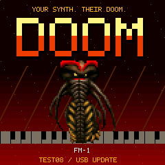
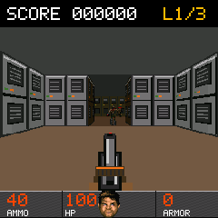
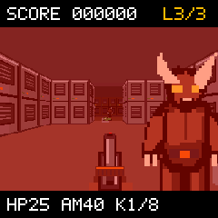

# Doom FM-1 / SMK

**Your synth. Their Doom.** A real Doom-engine port for the M-VAVE FM-1 and SMK-37 Pro / Elite, by Chance Roth (@ChanceTheMaker).

**Public installation is paused for FM-1, SMK-37 Pro and Elite following reports of device failures. Do not install previously downloaded Doom packages. [Status and recovery guidance](https://chancethemaker.github.io/doom-fm1-smk/#install).**

Test06 lacks a runtime USB MIDI updater. Test07 remains unreleased pending hardware validation. The build instructions below are development information, not a recommendation to flash a device.

  

Screenshots are actual engine output from the host harness at the device's 240 x 240 resolution.

## Test06

- Three connected-room levels: The Outpost, Iron Halls and Reactor Core.
- 18 enemies, directional guard/imp sprites, attacks and death animations.
- Shotgun, health/ammo pickups, kill scoring and readable health/ammo/level HUD.
- Original synthesized shotgun, reload, growl, impact, death, pickup and switch sounds.
- A new boot splash, readable LCD menus and white-key controls.
- Separate FM-1, SMK-37 Pro and SMK-37 Elite builds, all available in the website builder.
- Animated hardware hero: alternating FM-1/SMK screen zooms, seven FM-1 finishes and six SMK finishes, with pause and reduced-motion support.

| Model | Test06 application | Physical status |
| --- | ---: | --- |
| FM-1 | 557,576 bytes | Graphics and sound confirmed; adapter install fully read back |
| SMK-37 Pro | 557,452 bytes | Experimental; compiled and host-tested, physical Doom test pending |
| SMK-37 Elite | 557,452 bytes | Experimental; compiled and host-tested, physical Doom test pending |

The game uses a 240 x 180 viewport with LCD-resolution menus/HUD. A 256 KiB Doom zone and 24 KiB C heap keep it within the native memory budget. See [release checks](docs/TEST06.md) and [release hashes](site/firmware/releases.json).

## Install

1. Back up your synth projects. Have a working XIAO recovery adapter configured for your exact model.
2. Open the installer in desktop Chrome or Edge. Choose **FM-1**, **SMK-37 Pro** or **SMK-37 Elite**.
3. Click **Build firmware**. The browser downloads the reviewed app and checksum-pinned base, validates the model/layout, preserves protected bytes and prepares the package locally. A local base-file fallback is available; no file upload is needed normally.
4. Connect only that instrument by normal USB, running compatible synth firmware. SMKs support official matching **016** firmware or the portable Felucca/Sloop/Melodee SMK updater (identity version 922 or newer).
5. Close other MIDI apps, acknowledge the notice, then **Install / resume**. Keep USB and power connected until completion. Check the physical screen: USB MIDI disappearing when Doom starts is expected.

**Doom replaces the synth application and currently has no USB MIDI updater or persistent saves.** Installing another version or returning to synth firmware requires the recovery adapter. An installed Doom device cannot be discovered by the normal-USB website. FM-1 and SMK recovery write ranges differ; never use one model's image or write bounds for another. See [recovery notes](docs/FM1_TEST01.md) and [FM-1 transporter](https://github.com/kurogedelic/FM-1-transporter).

The Elite's official RAM loader can identify itself as `ota-FM-1`; the installer explicitly asks you to confirm the connected Elite before programming. It does not treat that generic identity as model proof. Failed handoffs do not automatically repeat writes.

Experimental firmware is provided without warranty. Power loss, an incompatible device or a software defect can require hardware recovery. FM-1 testing does not establish SMK hardware compatibility. No music, USB audio, multiplayer or synth functions are included.

## Controls

Count white keys from the far left (FM-1 starts at F; SMK starts at C).

| White key | Action |
| --- | --- |
| 1 / 3 | Turn left / right; adjust menu values |
| 2 / 4 | Forward / back; menu up / down |
| 5 | Fire |
| 6 | Use / retry after death |
| 7 / 8 | Menu / select |
| 9 | Run |
| 10 / 11 | Strafe left / right |

SMK **PATCH** opens the menu; **PARA** selects. Adjust sound under **Options > Sound**; FM-1 **MASTER** also controls output. Guards award 100 points, imps 200. Face the wall switch in the final room and press Use to exit. Fire or Use advances from results. Retry restores the score from level entry; finishing the campaign offers a fresh run.

## Build from source

Clone with submodules. Linux/WSL requires Python 3, GCC multilib, binutils and zdbsp 1.19. Native builds additionally require the JieLi pi32v2/r3 Linux toolchain (tested with `jieli-linux-toolchains-20250324.1`).

```sh
git clone --recurse-submodules https://github.com/ChanceTheMaker/doom-fm1-smk.git
cd doom-fm1-smk
python3 tools/fetch_test_wad.py
python3 tools/pack_test_wad.py --trim-textures
python3 tools/build_campaign.py
python3 tools/build_host.py --board fm1 --no-wipe --mapped-wad --small-room --static-wad --bounded-heap --abi32 --campaign
python3 tools/check_campaign.py build/fm1/strip-no-wipe-mapped-small-static-heap24-abi32-campaign/doom-host
python3 tools/check_menu.py build/fm1/strip-no-wipe-mapped-small-static-heap24-abi32-campaign/doom-host --campaign
python3 tools/build_native.py --board fm1 --campaign --toolchain /path/to/jieli/toolchain
python3 tools/build_native.py --board smk37-pro --campaign --toolchain /path/to/jieli/toolchain
python3 tools/build_native.py --board smk37-elite --campaign --toolchain /path/to/jieli/toolchain
```

Native outputs are app-only `.bin` files under `build/native/<board>/`, **not full-flash images**. The compiler does not flash devices. `tools/capture_screenshots.py` captures the campaign/splash from the host executable; converting PPM to PNG requires Pillow. The host harness uses scripted inputs rather than an interactive game window and can record synthesized effects to WAV.

The asset generator authors maps and pixel art over checksum-pinned [Miniwad](https://github.com/fragglet/miniwad) assets. Arbitrary retail WADs do not fit the measured budget. No commercial Doom assets are included.

## Website development and checks

```sh
python3 -m http.server 8786 --directory site
node tests/site_installer_test.mjs
node tests/site_installer_test.mjs /private/fm1-salt14.fwsc /private/Pro016.fwsc /private/Elite016.fwsc
python3 tools/check_site.py
```

Node 22 or newer is recommended. Optional original-firmware fixtures stay outside Git. Tests validate actual packages, protected data, corruption rejection, wrong-model refusal, loader failure paths and completion without a returning Doom MIDI identity. Tests use simulated transport and never open MIDI hardware.

GitHub Pages publishes only `site/` on pushes to `main`. Compiled apps are checksum-verified in CI; vendor packages, complete device dumps, calibration, build output and private backups are excluded. The browser downloads base files from pinned public sources and assembles packages on the user's computer.

## Analytics

The live site uses the shared GA4 property `G-JVF09MZEGD` for visits, firmware builds, downloads and installer results, tagged `product=doom-fm1-smk`. Cookie settings provide an opt-out. Localhost sends nothing, and no MIDI data, firmware files or raw logs are collected. See [event definitions](docs/ANALYTICS.md).

## Credits and license

New code: GPL-3.0-only, [LICENSE](LICENSE). DoomGeneric retains upstream Doom notices. Miniwad/Freedoom content retains its BSD-style license; mpaland/printf retains its MIT license. Hardware and updater work derives from Felucca by Leo Kuroshita / Hugelton Instruments and the Felucca, Sloop and Melodee SMK ports. See [THIRD_PARTY.md](THIRD_PARTY.md), [web credits](site/credits.html) and per-file provenance.

Independent community project; not affiliated with id Software, Bethesda or M-VAVE. Product names belong to their respective owners.
